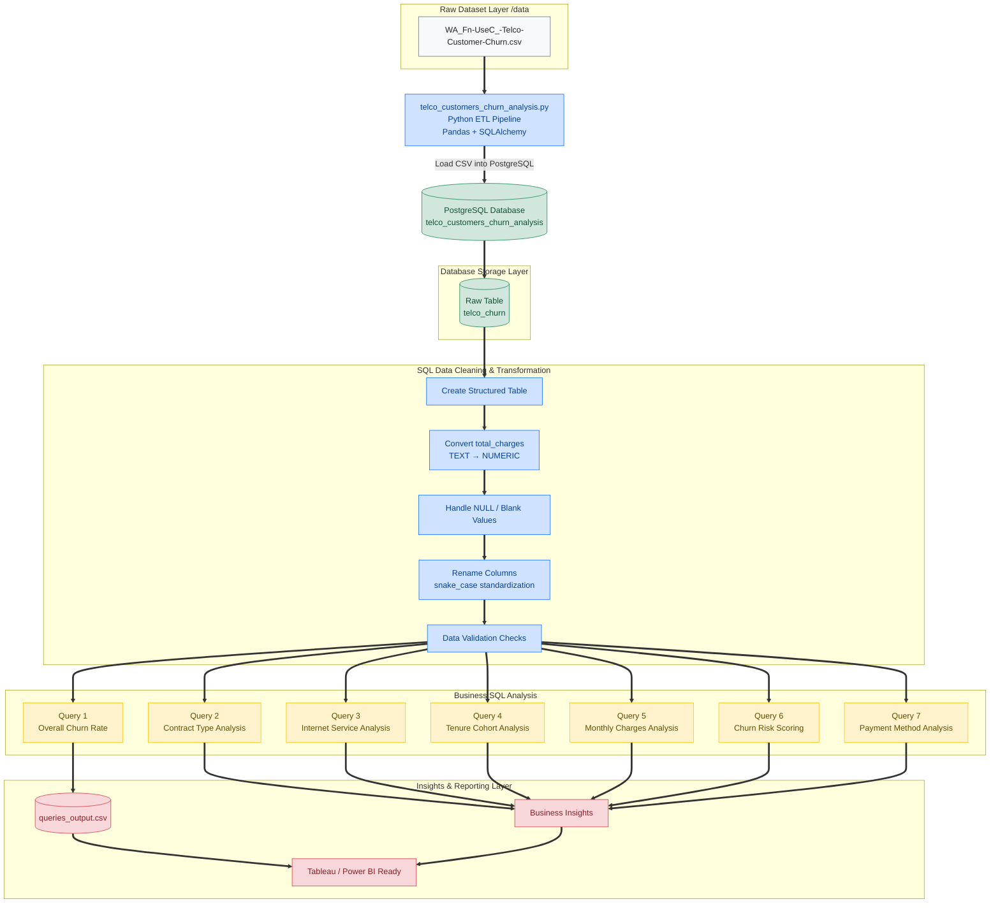

# SQL Customer Churn Analysis

A complete end-to-end SQL project analyzing telecom customer churn using PostgreSQL, Python, and Pandas.

---

# Project Overview

Customer churn is one of the biggest business problems in the telecom industry.  
This project analyzes customer behavior, contract patterns, billing information, and service usage to identify churn drivers and high-risk customers.

The project includes:

- Data import using Python + Pandas
- PostgreSQL database creation
- Data cleaning and transformation
- Exploratory SQL analysis
- Business-focused churn insights
- Customer risk scoring model

---
# Data Flow Architecture



# Dataset

Dataset Source:
Telco Customer Churn Dataset from Kaggle

File Used:
`WA_Fn-UseC_-Telco-Customer-Churn.csv`

Total Records: 7043 customers

---

# Tech Stack

- PostgreSQL
- SQL
- Python
- Pandas
- SQLAlchemy

---

# Project Workflow

## 1. Data Import

The CSV dataset was imported into PostgreSQL using Python and Pandas.

Python script:
`python/telco_customers_churn_analysis.py`

Main tasks:
- Read CSV file
- Create PostgreSQL connection
- Upload dataset into PostgreSQL table

---

## 2. Database Setup & Data Cleaning

Performed several cleaning operations:

- Created structured SQL table
- Converted `TotalCharges` from text to numeric
- Handled blank values
- Renamed columns into SQL-friendly naming convention

Example:
- `customerID` → `customer_id`
- `MonthlyCharges` → `monthly_charges`

---

## 3. Business SQL Analysis

Performed multiple business-driven SQL analyses:

### Key Analyses

1. Overall churn rate
2. Churn by contract type
3. Churn by internet service & security add-ons
4. Tenure cohort analysis
5. Monthly charge comparison
6. Customer churn risk scoring
7. Churn by payment method

---

# Key Insights

## 1. Overall Churn Rate

- Total Customers: 7043
- Churned Customers: 1869
- Retention Rate: 73.46%

---

## 2. Month-to-Month Customers Have Highest Churn

| Contract Type | Churn Rate |
|---|---|
| Month-to-month | 42.71% |
| One year | 11.27% |
| Two year | 2.83% |

Insight:
Long-term contracts significantly reduce churn.

---

## 3. Fiber Optic Customers Without Security Add-ons Churn Most

- Fiber optic customers without online security:
  - Churn Rate = 49.36%

Insight:
Security services strongly improve retention.

---

## 4. New Customers Are Most Likely to Churn

| Tenure Group | Churn Rate |
|---|---|
| 0-12 months | 47.44% |
| 60+ months | 6.61% |

Insight:
Early customer engagement is critical.

---

## 5. Churned Customers Pay Higher Monthly Charges

| Customer Type | Avg Monthly Charge |
|---|---|
| Retained | 61.27 |
| Churned | 74.44 |

Insight:
Higher pricing may increase churn risk.

---

## 6. High-Risk Customer Segmentation

Created a rule-based churn risk scoring model using:
- Tenure
- Contract type
- Monthly charges
- Internet service
- Tech support

Results:
- High Risk Customers: 14.84%
- Medium Risk Customers: 33.11%
- Low Risk Customers: 52.05%

---

# Files Included

| File | Description |
|---|---|
| `python/telco_customers_churn_analysis.py` | Python ETL script |
| `sql/telco_customers_churn_analysis.sql` | Database setup & cleaning |
| `sql/queries.sql` | Business SQL analysis queries |
| `output/telco_customers_churn_analysis_queries_output.csv` | Query outputs |
| `data/WA_Fn-UseC_-Telco-Customer-Churn.csv` | Dataset |

---

# How to Run the Project

## 1. Clone Repository

```bash
git clone https://github.com/P568848382/sql-customer-churn-analysis.git
```

## 2. Install Dependencies

```bash
pip install -r requirements.txt
```

## 3. Create PostgreSQL Database

```sql
CREATE DATABASE telco_customers_churn_analysis;
```

## 4. Run Python Script

```bash
python python/telco_customers_churn_analysis.py
```

## 5. Run SQL Scripts

Execute:
- `telco_customers_churn_analysis.sql`
- `queries.sql`

---

# Future Improvements

- Build Power BI Dashboard
- Create Tableau Dashboard
- Add predictive churn modeling using Machine Learning
- Automate ETL pipeline
- Deploy dashboard online

---

# Author

Pradeep Kumar
